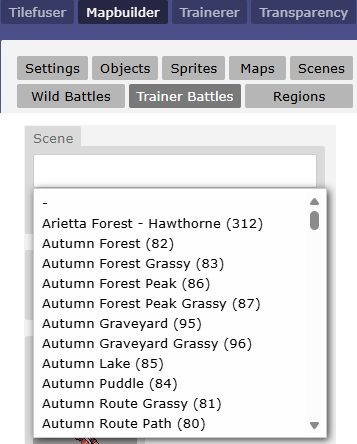
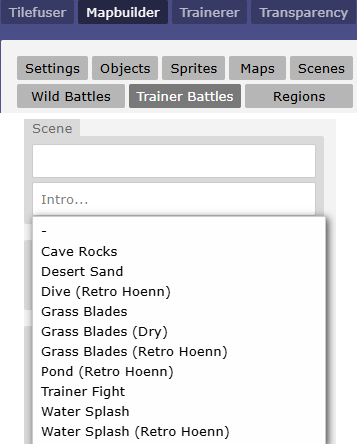

# Battle Properties
You can set various battle properties, when you call for it to start within an objects code. This applies to both wild battles and trainer battles. The properties are listed below.

## Battle Limiters
### No Running
You cannot run from this battle. This is the default setting for trainer battles, so you only need to specify it for wild battles.
```json
norun
```
### No Catching
You cannot catch the opposing Pokemon. This is the default setting for trainer battles, so you only need to specify it for wild battles.
```json
nocatch
```
### No Money
You will not earn money from this battle. This is the default setting for wild battles, so you only need to specify it for trainer battles.
```json 
nomoney
```

### Fixed amount of Money
The player will earn this amount of money from winning the battle.
```json 
payout value
```

### No Experience Points
Your Pokemon will not gain any experience points from this battle.
```json
noexp
```

### Never Shiny
The encountered mon will never be shiny.
```json
noshiny
```

### No Item Use
You will not be able to use items from the bag widget during battle. For example, Poke Balls or Potions.
```json 
noitems
```

### No Blacking Out
Prevents the player from blacking out if they lose the battle.
```json 
noblackout
```

### No Mega Evolutions
Prevents the mega evolutions from occurring.
```json 
nomegas
```

### Set Style
The battle uses set style (the player is not asked to switch before the opponent sends out a new mon).
```json 
setstyle
```

### Fixed Pokemon Level
Forces all Pokémon in battle to the specified level. Uses their true stats (IVs, EVs) but calculates the actual stat value (attack, etc) based on the new set level. This works identically to fixed level battles such as the Battle Tower in the mainline games.
```json
fixedlevel
fixedlevel level
fixedlevel side1,side2
```

- If no arguments are given, each side is level 50.
- If one argument is given, each side uses that level.
- If two arguments are given, each side has a different fixed level (e.g., `fixedlevel 50,60`).
### Hidden Opposing Pokemon Level
Levels of the opposing Pokémon are hidden. Appears as ???.
```json 
hiddenlevel
```

### Mon Order
Causes the NPC to use mons in the order specified (by comma-separated slots).
```json 
monorder list
```
Here, `list` is comma-separated slots, like `2,1,3`. You can also include `r` for a random slot, like `2,r,3`.

## Automatic Evolution

When [dynamic leveling](<https://pokengine.readthedocs.io/en/latest/Code_Library/pokemon-generation/#dynamic-levelling>) is active, sometimes it makes sense for the Pokémon to automatically evolve. This is great for situations where the player might otherwise encounter a level 25 Caterpie.

```json 
autoevolve mode
```

When enabled, automatic evolution has four modes:

- Mode 1 - Default, will evolve mons via level-up. Non–level-ups (such as stone evolutions) will evolve at specific breakpoints and will prioritize the first evolution in an evolutionary chain.
- Mode 2 - Will specifically prioritize alternate evolution methods (such as stone evolutions) instead of level-up evolutions.
- Mode 3 - Will pick all possible evolutions, but will remain consistent across every battle due to seeding. For example, a battle that uses a Rockruff and Mode 3 may result in having a Lycanroc Midnight. Due to seeding, once the Lycanroc Midnight is chosen once, it will also be chosen at different levels for that particular encounter.
- Mode 4 - Only evolves level-up evolutions, non–level-ups do not evolve.

If you want to configure autoevolve for all battles on a map, you can use the trigger
```json 
mapvar[autoevolve_all]=mode
```
Similarly, for all battles in a region, you can set the variable in the region variables:
```json 
var[autoevolve_all]=mode
```

## Weather
Sets the weather before the battle starts. The weather will last indefinitely.

```json 
weather name
```

The canonical weather options are:

<style>
.weather-columns ul {
    margin-top: 0;
}
</style>

<div class="weather-columns" style="column-count: 3; column-gap: 20px;" markdown="1">
- `clear`
- `extremelyharshsunlight` (non-functional)
- `fog`
- `hail`
- `harshsunlight`
- `heavyrain` (non-functional)
- `rain`
- `sandstorm`
- `snow`
- `strongwinds` (non-functional)
</div>

Some custom options are:

<style>
.weather-columns ul {
    margin-top: 0;
}
</style>

<div class="weather-columns" style="column-count: 3; column-gap: 20px;" markdown="1">
- `ash`
- `blizzard`
- `cherry`
- `confetti`
- `darkovercast`
- `downpour`
- `duststorm`
- `grassblades`
- `hailstorm`
- `leaves`
- `mist`
- `overcast`
- `pink-petals`
- `soot`
- `spooky`
- `sprite`
- `storm`
- `windy`
- `yellow-petals`
</div>

## Terrain
Sets the terrain before the battle starts. The terrain will last indefinitely.

```json
terrain name
```

Options are:

- `electric`: Boosts Electric-type moves by 30% for grounded Pokémon. Prevents grounded Pokémon from falling asleep.
- `grassy`: Boosts Grass-type moves by 30% for grounded Pokémon. Grounded Pokémon recover 1/16 max HP each turn.
- `misty`: Halves damage from Dragon-type moves against grounded Pokémon. Prevents grounded Pokémon from being statused.
- `psychic`: Boosts Psychic-type moves by 30% for grounded Pokémon. Grounded Pokémon are protected from priority moves.
- `swarming`: Boosts Bug-type moves by 30% for grounded Pokémon. Prevents all healing.
- `filthy`: Boosts Poison-type moves by 30% for grounded Pokémon. Doubles poison damage to grounded Pokémon.
- `shady`: Halves damage from Fairy-type moves against grounded Pokémon. Adds +0.75x to critical hit damage against grounded Pokémon.

## Battle Format
### Double Battles
The battle will be changed to the 'double' format of Pokemon battles. This can be applied to both wild and trainer battles.
```json
double
```
### Triple Battles
The battle will be changed to the 'triple' format of Pokemon battles. This can be applied to both wild and trainer battles.
```json 
triple
```
### Safari
Enables the battle to be safari-style (special catch rules).
```json 
safari
```
### Horde Battles
Creates a horde battle (1 vs N opponents that duplicates a single wild mon).
```json 
horde
horde N
```
If `N` is omitted, a random number between 1 and 6 will be selected.

### Ghosts!
Enemy combatants are treated like ghosts. Similar to Marowak's ghost in Lavendar Town, the player's mons will not be able to attack.
```json 
ghosts
```

### PvP
Configures the match to be player-vs-player (no victory/defeat speech, can forfeit without blacking out, forces set style, allows held items to be recovered, and so on).
```json
pvp
```

### Not Wild
Makes the introductory text "A Magikarp approches for battle!" instead of "A wild Magikarp appeared!".
```json
notwild
```

## Pokedex Registration

### Not Seen in Pokedex
The opposing Pokemon in this battle, will not be counted as seen in the Pokedex.
```json
noseen
```

## On Caught
Executes a trigger upon successfully catching the wild mon.
```json 
oncaught trigger
```
Example usage:
```json
msg(Hi!)&battle=3500;oncaught ev[defeated_derrick]=1
```

!!! note
    Currently, you cannot chain triggers together with `&` because the engine will interpret that as a brand new trigger (rather than a part of the `&battle=` trigger).

## On Won
Executes a trigger upon successfully winning a battle.
```json 
onwon trigger
```

## On Lost
Executes a trigger upon losing a battle.
```json 
onlost trigger
```

## On Ran
Executes a trigger upon running away from a battle.
```json 
onran trigger
```

## Battle Scene Alterations

### Battle Background (Scene)
Sets the battle scene (background image) to the one specified. Only necessary for wild battles, as trainer battles have a scene property set in advance. Additional scenes are added for battles, using the scene context menu in the Mapbuilder editor.


```json
scene id
```
Id options are the numbers that appear in parentheses (e.g., `82` for Autumn Forest).

### Battle Intro
Sets the battle intro (animation) to the one specified. Similar to scenes, the intros may be found in the context menu in the Mapbuilder editor.


```json
intro name
```
Name options are

- `cave`
- `sand`
- `retro-hoenn-dive`
- `grass`
- `grass-dry`
- `retro-hoenn-grass`
- `retro-hoenn-pond`
- `trainer`
- `splash`
- `retro-hoenn-splash`.

### Battle Theme (Audio)
Sets the music playing during battle. Currently, only hosting on Dropbox is supported. The format is db: for host, then a modified URL which cuts out the https://www.dropbox.com/ part.
```json
theme url
```
Usage:
```json
theme db:s/fo7smcp2luvrikc/BattleTowerSWSHRemix.mp3
```
See also [Setting a Song for Specific Trainer Battles](<https://pokengine.readthedocs.io/en/latest/HowTo_Guides/music-settings/#setting-a-song-for-specific-trainer-battles>).

### Victory Theme
Similar to the battle theme, you can select a track to play when the player whens the battle.
```json
victorytheme url
```

## Trainer and Team Alterations
Particularly useful for randomized battles, these options allow developers full customization without changing the battle ID.

### Override Trainer
To customize the trainer's name and skin, use:
```json
overridetrainer name="newName",outfit="UID"
```
Here, each entry is optional, but the name and UID **must be in double quotes**. As an example, see:
```json
battle=3500;overridetrainer name="Kerry",outfit="015icsxz"
```
which would change battle 3500's trainer from Gardener Derrick to Wave-Girl Kerry.

### Override Mon
To customize the enemy party, use:
```json
overridemon 1="uid1",2="uid2",...
```
where `uidN` are each mon's UID. This string **must be in double quotes**. As an example, see:
```json
battle=3500;overridemon 1="00bxxu0w"
```
which would change battle 3500's first mon from a Cutiefly to a Pikachu. Note that the level of the mon doesn't change (it's level 23 either way). The rest of the party remains the same as well.

## Transition
Sets the screen transition animation used when entering the battle.
```json 
transition type
```
Type options:

- `0` - Diagonal wipe (64×64 squares sweep diagonally across the screen)
- `1` - Grid fade (16×16 grid lines fade in)
- `2` - Venetian blinds (alternating 16px horizontal strips fade from top and bottom)
- `rocket` - Team Rocket style transition (animated 12-frame sprite sheet)
- `-1` or omitted - Random transition (picks 0, 1, or 2 randomly)

### No Shadow
Neither teams' mons will cast shadows.
```json 
noshadow
```

## Examples
### Wild Pokemon Boss
This first example is a boss battle against a wild Pokémon. You cannot run or catch it, and the level is hidden. The Pokémon’s name is also set to hide its species.
```json title="Code Example" 
msg(Groouuugoooough!!)&!cry=00bxxu0w&battle=00bxxu0w;level 80;name ???;scene 51;hiddenlevel;nomoney;nocatch;norun
```

### Battle Tower
Battle Tower This example is from the HUB Battle Tower. The dialogue in the `msg()` block and the trainer battle ID are both controlled by a list. The variable `var[noblackout]=1` is set so that the player will not teleport away if they lose the battle.

Similar to the mainline games’ Battle Tower, this battle gives no exp or money, but instead I manually give the player BP if they win (not shown). Items are not allowed, and all participating Pokémon are set to level 50 for the duration of the battle.
```json title="Code Example" 
msg(%list[trainers][n].speech%)&var[noblackout]=1&mapvar[battle]=3&battle=%list[trainers][n].battleid%;noexp;nomoney;noseen;noitems;fixedlevel 50;theme db:s/fo7smcp2luvrikc/BattleTowerSWSHRemix.mp3
```

## Advanced - AI Routines

### Overview

Routines are comma-separated tokens that control NPC AI behavior for move selection, switching, item use, hazard/weather setup, and other decisions. They are set per-npc (not per-mon).

### Source precedence

1. `config.routines` (battle config string, described here)
2. `trainer.skillLevel` (trainer instance)
3. `TRAINERS[individual]` or `TRAINERS[trainerClass].skillLevel`
4. fallback: `["beginner"]` for trainers, `["random-5"]` when no trainer

### How the AI picks an action

1. Every move/target gets a score from the routines. Scores are floored at 1, so a "worst score" move ends up at 1 rather than being removed. A move the mon can't use at all scores 0.
2. Switch-out and item-use scores are added to the pool as extra actions.
3. If anything scores above 0, one is chosen **at random, weighted by score**:
   - candidates scoring below 50% of the top score are dropped entirely,
   - the rest are weighted by `score³`, so a score twice as high is picked about 8× as often.
4. With `highestscore`, the weighting is skipped and one of the top-scoring options is chosen.
5. If nothing is usable, the mon uses Struggle.

This means a big gap in scores (like `ohko-200` or a healing item at 99) makes that action close to guaranteed, while small differences between moves still leave some unpredictability.

### Format

```json
routines token1,token2,token3
```

**Examples:**

- Basic trainer with simple AI:
  ```json
  routines beginner
  ```

- Advanced trainer that sets hazards and switches strategically:
  ```json
  routines skilled
  ```

- Advanced trainer that never uses items:
  ```json
  routines skilled,no-useitems
  ```

- Beginner that also switches out offensively:
  ```json
  routines beginner,offensiveswitchout-0.5
  ```

- Custom trainer that damages with a bit of randomness and never uses items (just leave `useitems` out):
  ```json
  routines damage,typing,stab,accuracy,random-5
  ```

- Trainer that sets weather and hazards, and otherwise picks mostly at random:
  ```json
  routines rain-10-20,stealthrock-15,spikes-15-3,random-3
  ```

Routines may be negated by using the `no-` prefix (like `no-setweathers`).

### Individual routines
*Flags* (change how other routines behave, they don't score on their own)

- `typing`
  - Enables type-effectiveness checks in `damage` and in the `inflict*` routines (status immunities, zero-effectiveness moves).
  - Without it, `damage` treats every move as neutral.

- `stab`
  - Makes `damage` apply a 1.5× multiplier when the move's type matches one of the user's types. No effect without `damage`.

- `cautiousmultistrike` / `optimisticmultistrike`
  - Control how `damage` values multi-hit moves. Default is an averaged hit count (`round((minHits + maxHits) / 2.5)`); `cautiousmultistrike` assumes `minHits`, `optimisticmultistrike` assumes `maxHits`.

- `highestscore`
  - Turns off weighted-random selection. The AI always picks one of the top-scoring options (ties are broken randomly).

*Damage and damage-related*

- `damage`
  - Scores damaging moves (and flat-damage moves) as `power / 10` (flat-damage moves count as 5), multiplied by:
    - type effectiveness (needs `typing`),
    - STAB (needs `stab`),
    - the multi-strike modifier,
    - 0.75 when a multi-target move hits more than one target.
  - Hitting an ally counts as negative.
  - Zero effectiveness gives the worst score.

- `random-N`
  - Adds `randInt(1, N)` to each valid target's score; larger N means more variance. Targets that aren't valid (e.g. an ally for a move that targets enemies) get nothing.
  - Example: `random-5` adds 1-5 points.

- `explode-N`
  - Multiplies the score of exploding moves by N. Example: `explode-5` makes explosions far more attractive.

- `smartexplode`
  - Multiplies the score of exploding moves by `1 - selfDamage x currentHpFraction`. The penalty is largest at full HP and shrinks as the user's HP drops (it has less to lose).

- `ohko-N`
  - Adds N to the score of moves classified as OHKO moves. Example: `ohko-200`.

- `smartohko`
  - Gives OHKO moves the worst score when they would fail: the target's level is higher than the user's, the target is an immune type, or the target's HP fraction is at or below the move's minimum HP threshold.

- `failedmove-N`
  - Penalizes moves that have already failed against the same target.
  - The penalty is `N × (number of failures)`. Example: with `failedmove-5`, a move that has failed twice against a target loses 10 points against that target.
  - A "failure" is a move that failed outright or had no effect (immunity) on that target. Misses and protected hits are not counted.

*Status infliction*

- `inflictparalysis-B-A` / `inflictsleep-B-A` / `inflictpoison-B-A` / `inflicttoxin-B-A` / `inflictburn-B-A` / `inflictfreeze-B-A` / `inflictconfusion-B-A` / `inflictinfatuation-B-A`
  - Apply to any move (status or damaging) that can inflict the matching status.
  - B = base score, A = ally penalty. Both are required.
  - Enemy target that can be afflicted: `+B × (the move's status chance)`.
  - Ally target: `-A`.
  - Target that already has the status, is immune, or when the user isn't on the field: the worst score for pure status moves, no bonus for damaging moves.
  - Immunity checks need `typing`: paralysis (Electric), poison/toxin (Steel, Poison), burn (Fire), freeze (Ice). Sleep, confusion and infatuation have none.
  - If `typing` is on and the move has zero effectiveness against the target, the result is 0.

*Category boosts* (not part of any preset)

- `statusmoves-N` / `damagemoves-N` / `physicalmoves-N` / `specialmoves-N`
  - Add N to every move of that category. `damagemoves` covers physical and special.
  - Example: `statusmoves-10` adds +10 to all status moves.

*Field setup*

- `stealthrock-B` / `stickyweb-B`
  - Adds B if the hazard isn't already on the opponent's side. Worst score if it is, or if the user isn't on the field.

- `spikes-B-S` / `toxicspikes-B-S`
  - Adds B if the hazard isn't set. If it is set but not at max layers, stacking more is still scored: for `toxicspikes`, `B + S × (extra layers already down)` (it wants to keep stacking); for `spikes`, `B - S × (extra layers already down)` (each extra layer is worth less). Worst score once at max layers.

- `rain-F-O` / `harshsunlight-F-O` / `sandstorm-F-O` / `snow-F-O` / `darkovercast-F-O` / `fog-F-O`
  - F = bonus when the sky is clear, O = bonus when overwriting a different weather. Both are required.
  - Worst score if that weather is already active or if the user isn't on the field.

- `statboost-B`
  - For stat-boost moves: adds B only when the mon was just sent out and hasn't moved yet. Otherwise the worst score, so the AI doesn't keep boosting forever.

*Other scoring*

- `priority-B`
  - For priority moves, multiplies the score by `1 + B × (1 - targetHpFraction)`: the lower the target's HP, the more valuable it is to strike first.

- `accuracy`
  - Multiplies the score by `move.accuracy / 100` (moves with no accuracy count as 100). Because it multiplies, it's applied last.

*Switching and items* (trainers only; these are scored as actions, not as moves)

- `offensiveswitchout-X`
  - Enables switching. For each teammate that is conscious and not already queued to come in this turn, the AI scores the best move that teammate would have, multiplied by X. That is the score for "switch out", which then competes with the current mon's moves.
  - X is a multiplier, so **lower values make switching less attractive** (`offensiveswitchout-0.5` halves the teammate's score). X is required.
  - Skipped if the mon can't switch out (volatile statuses, or an opposing ability that traps).
  - Also used when a fainted mon has to be replaced: instead of a random teammate, the AI sends out the one with the best-scoring move (unless the battle config sets a `monOrder`, which takes priority).

- `useitems`
  - Evaluates usable items in the trainer's bag. Currently only healing items are supported: an item scores 99 when the mon's HP is below 35%, or when the HP it's missing is at least the item's heal amount. Anything else scores too low to be used.
  - Items already used this turn are skipped.

- `savelastmon`
  - When picking a teammate to switch in, removes the last eligible teammate (last conscious, not-yet-queued mon in party order) from consideration, so the AI doesn't send it out prematurely. The same applies when replacing a fainted mon: if more mons are available than slots to fill, the last conscious mon in party order is held back. Not part of any preset.

### Predefined routine presets

| Preset | Expands to                                                                                                                                                                                                       |
|---|------------------------------------------------------------------------------------------------------------------------------------------------------------------------------------------------------------------|
| `random` | *(no routines at all, picks totally randomly)*                                                                                                                                                                   |
| `noob` | `damage`, `typing`, `failedmove-1`, `useitems`, `optimisticmultistrike`, `ohko-200`                                                                                                                              |
| `beginner` | `inflictstatus`, `damage`, `accuracy`, `typing`, `stab`, `failedmove-5`, `useitems`, `cautiousmultistrike`, `ohko-200`                                                                                           |
| `kamikaze` | `beginner`, `explode-5`                                                                                                                                                                                          |
| `gambler` | `beginner`, `ohko-1000`                                                                                                                                                                                          |
| `skilled` | `inflictstatus`, `sethazards`, `setweathers`, `damage`, `accuracy`, `typing`, `stab`, `failedmove-10`, `offensiveswitchout-0.5`, `statboost-15`, `priority`, `useitems`, `smartexplode`, `ohko-200`, `smartohko` |
| `expert` | same as `skilled`, but `failedmove-20`                                                                                                                                                                           |

### Predefined routine groups

| Group | Expands to |
|---|---|
| `inflictstatus` | `inflictparalysis-10-20`, `inflictsleep-10-20`, `inflictpoison-10-20`, `inflicttoxin-10-20`, `inflictburn-10-20`, `inflictfreeze-10-20`, `inflictconfusion-7-20`, `inflictinfatuation-7-20` |
| `sethazards` | `stealthrock-15`, `toxicspikes-15-3`, `spikes-15-3`, `stickyweb-15` |
| `setweathers` | `rain-10-20`, `harshsunlight-10-20`, `sandstorm-10-20`, `snow-10-20`, `darkovercast-10-20`, `fog-10-20` |

### Warnings

Code not working like you expect? Remember the following:
- Parameters are required. A routine like `rain` or `ohko` without a dash and number does nothing.
- Presets win over directly listed values. For example, `beginner,failedmove-10` quietly ends up as `failedmove-5` because that was defined first inside `beginner`.
- 