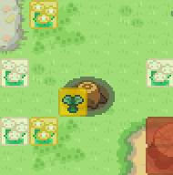

## Summary

Adds Honey Trees as a new interactable map object, following the Gen 4 mechanic: slather honey, wait, tree shakes, guaranteed encounter.

The code is simply - `honeytree(encounter-list-name)` 
You can make this a root object if you want.

There are a few Pokengine-specific changes:

- A single encounter list instead of A/B/C groups.
- No Munchlax-tree distinction.
- A significant departure from Gen 4: **encounters never expire**. Once a tree starts shaking, it continues shaking until the encounter is fought, whether that’s 10 minutes or 10 hours later.

It also introduces a second tier, **Rare Honey**, and a new general-purpose compiler mechanism for multi-tile objects that share one interactive instance.

---

## Core Mechanic

Interact with an idle tree:

- If the player has Honey and/or Rare Honey, they are offered the option to slather.
- If they have both, they are asked which one to use.
- If they have no honey, the tree only displays flavor text with no dead-end prompt.

Slathering immediately rolls two things:

1. Whether the tree will produce an encounter.
2. How long the tree will take to become active.

There is a **90% chance of producing an encounter** when using regular Honey.

- The remaining 10% is a "dud".
- Rare Honey will not produce a dud, always a hit.
- A dud is indistinguishable from an idle tree once its wait elapses.
- No message is shown and the honey is simply consumed, matching the behavior of the real games.

Wait time is randomized in **30-minute in-game increments**, weighted toward the middle using a sum-of-two-dice roll rather than a flat uniform distribution.

  - **Regular Honey:** 3–9 in-game hours, peaking at 6 hours.
  - **Rare Honey:** 1.5–4.5 in-game hours, peaking at 3 hours.
  

Rare Honey uses its own native range rather than halving the regular range, since halving an odd 30-minute step would produce 15-minute offsets and break the intended increment.
Checking a waiting tree displays which honey is currently applied, using the real item name from `ITEMS[uid].name` rather than hardcoded text.

- Checking a shaking tree gives a **guaranteed encounter**.
- This does not use the normal Rock Smash/Cut-style chance of finding nothing.
- `findEncounter`'s existing pity-timer mechanic is reused by setting `player.encountered = 30`, forcing its internal chance gate to pass.
- Pokémon selection itself is therefore still handled by the existing encounter system.

!!! note
    As mentioned, please note that encounters will always persist. They won't go away over time. Also note that the time for honey tree encounters will continue counting even while offline - neat!

---

## Rare Honey

Introduces **Rare Honey** as a separate honey tier.

- Has its own drop source - 15% chance from honey gather ability.
- Always produces an encounter, unlike regular Honey’s 90% chance.
- Provides a shorter effective wait time.
- The wait range is rolled natively as **1.5–4.5 in-game hours**, with a peak at 3 hours.

This follows the existing philosophy of better rod tiers: better access and odds are balanced by scarcity rather than making the regular tier obsolete.
Encounter lists are optional per tree:

  - `honeytree(list)` → Rare Honey falls back to the regular encounter list.
  - `honeytree(list,rare-list)` → Rare Honey uses its own distinct encounter pool.

!!! note
    Rare honey is **completely optional**, you do not need to cater for it if you don't want. The honey trees will work fine without it.
    
---

## Multi-Tile Footprint

Honey Trees occupy a **2×2 area** from a single `honeytree(list)` placement:

- Anchor tile
- Right tile
- Up tile
- Up-right tile

No manual per-tile authoring is required.

Only the anchor tile renders the foliage sprite, offset **13px upward** so that it sits correctly above the separately placed trunk map art.

The other three tiles are:

- Solid
- Interactive
- Invisible

All four tiles share:

- One persisted state
- One encounter list
- One interactive instance

This introduces a new reusable JCOAD pattern:

`@link|anchorX|anchorY|list`

The compiler automatically generates the three additional tiles from a single `honeytree()` call. The functionality is therefore not honey-tree-specific and can be reused by other multi-tile objects.

!!! note
    It might look a bit confusing, as only one object is required. The other 3 wont be visible, but they're essentially solid objects. Please take note to place the honey tree object always on the bottom left!

---

## Persistence

Honey Tree state is packed into a single `eventVars` key:

`(honeytree,map,x,y)`

The stored value contains:

- Schema marker
- Has-encounter flag
- Is-rare flag
- Wait step (`0–12`)
- Slather timestamp

The tree's current state is derived from **real elapsed time** whenever it is checked.

Nothing is proactively cleared.

A dud simply reverts to the idle state once its wait time has elapsed, without requiring any additional write.

---

## Achievements

Every successful slather fires all three slather-milestone achievement UIDs together:

`achievement=UID1&achievement=UID2&achievement=UID3`

This follows the existing `Battle.CRITICAL_CAPTURE_ACHIEVEMENTS` pattern.

The site tracks the player's actual slather count and determines which achievement threshold has been crossed. There is therefore no client-side counter or threshold logic that could become out of sync.

!!! note
    The honey slather achievements are Global, so it will count towards them regardless of Region. But, it will also apply a `honey_slathered` incremental ev that is regional and will wipe on reset. So you can use this for gameplay if you wish. (Maybe be refactored in future).
