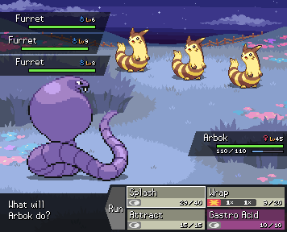
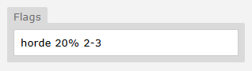
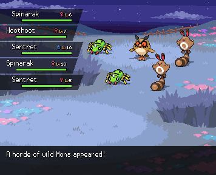
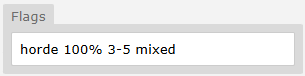
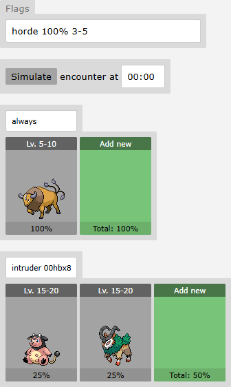
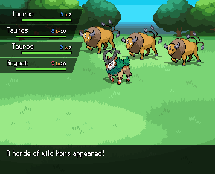

# Horde Battles

## Introduction

A **horde battle** is a way for a trainer to [encounter](<https://pokengine.readthedocs.io/en/latest/Code_Library/objects/#encounters>) multiple wild mons in a single battle. Such battles can be 1v2, 1v5, or anything in between. 

As a developer, you have multiple ways to implement horde battles. Use whichever approach best fits the structure and design of your region.

## Horde Chance Encounters
Regular grass has a chance to trigger a horde instead of a standard encounter.

- Shares the same encounter pool, rarity and level ranges as your normal wild encounters.

- Good for casually mixing hordes into standard gameplay.

In this example, every wild encounter has a **20% chance** to be a horde, consisting of **2 to 3 Pokémon.** The remaining 80% of battles will be traditional 1v1 single wild battles.

## Dedicated Horde Grass
Use `100%` and separate grass tiles specifically for horde-only encounters.

- Gives you full control over what Pokémon appear, their levels, rarity, and even specific mechanics.

- Ideal for special zones, unique challenges, post-game content.

## Mixed Horde Battles

The species of horde battles can also be intermixed. To do so, use `mixed`

!!! warning "Shiny Rolls"

    Each additional Pokémon in a horde increases the number of shiny rolls (i.e. a horde of 5 gives 5 chances per encounter). This massively boosts shiny odds, so hordes larger than 3 should be reserved for **post-game content only.**
    
    Keep horde sizes to a maximum of **3 Pokémon** during the main game.

## Intruder Horde Battles

 

"Intruders" are Mons of a different species that have a chance to appear alongside a horde of another species.

- **One intruder at most** (but it could also be zero intruders).
- **Species-specific:** The format is intruder [uid of the species it can intrude in]. For example, intruder 00hbx8rg allows the specified Mon to intrude into Tauros hordes, but not hordes of other species.
- The percentage (25% in the given example) is the odds of appearing within that horde of Mons.
- You could list more than one intruder, but only one will ever appear. In the given example, 50% of Tauros hordes will have some kind of intruder (25% + 25%).

# Official uses uses

Intruders can be used to represent natural relationships or behaviours between species, such as:
- Allies or companions: Species that are commonly found together, such as Plusle and Minun.
- Mimicry and camouflage: A Mon that disguises itself among another species, or takes advantage of the protection provided by blending into a group, such as a single Sudowoodo in a horde of trevenant.
- Symbiosis: A species that lives alongside another for mutual benefit, such as gaining protection or access to food.

Official examples
- Plusle / Minun
- Nidoran♂ and Nidoran♀
- Roggenrola and 1 Carbink
- Tauros and 1 Miltank
- Trevanant and 1 Sudwoodo

# Expanded uses

But we can take this even further! Intruders could represent family groups, with a baby among its evolved species or a powerful Mon protecting its pre-evolutions.
- Baby Pokémon: One Cleffa among a horde of Clefairy, could even make it lower level than the Clefairy.
- Guardians/Parents: One Bisharp among a horde of Pawniard, acting as their protector. This could mimic the Pokémon behaviour seen in Scarlet and Violet. You could even give it a unique held item, such as a [Leader's Crest], obtainable only from these hordes.

!!! note "Rival Hordes"

    Pokengine currently doesn’t support _rival_ horde combinations, where two species target each other if they appear in the same horde (e.g. Seviper and Zangoose, or Durant and Heatmor), or _predator/prey_ combinations, where one species targets the other (e.g. Mareanie targeting Corsola). Both features are on our roadmap.
