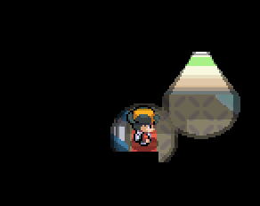
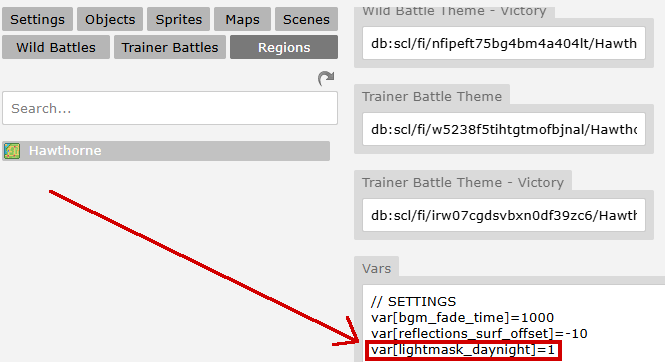

# Lightmask System



---

## Cheat Sheet

| Thing                       | Consequence                                                                                                                                                                                                                                                                                                             |
|-----------------------------|-------------------------------------------------------------------------------------------------------------------------------------------------------------------------------------------------------------------------------------------------------------------------------------------------------------------------|
| `var[lightmask_daynight]=1` | Uses the lightmask day/night system instead of the tint-based day/night system.                                                                                                                                                                                                                                         |
| `sprite(file,lm_overlay)`   | Causes the sprite to render on the lightmask layer as a cuttable object. See [depth](<https://pokengine.readthedocs.io/en/latest/Using_This_Guide/understanding-datatypes/#depth>).                                                                                                                                     |
| `sprite(file,lm)`           | Causes the sprite cut on the lightmask layer (but does not allow it to render). See [depth](<https://pokengine.readthedocs.io/en/latest/Using_This_Guide/understanding-datatypes/#depth>). <br/><br/>Also works with [animations](<https://pokengine.readthedocs.io/en/latest/Using_This_Guide/understanding-definitions/>). |
| `sprite(file,hud)`          | Causes the sprite render above the lightmask layer. See [depth](<https://pokengine.readthedocs.io/en/latest/Using_This_Guide/understanding-datatypes/#depth>).                                                                                                                                                          |

---

## Basic Examples

### Overlay
Sets an overlay that's always on top of the player:
```json
vignette_medium_overlay=sprite(186753/hawthorne-light-mask_overlay2,lm_overlay)
vignette_medium_overlay.glue(0,0)
```

### Cutter (Hole)
Cuts a hole in the overlay at a fixed world position:
```json
sprite(2156/lm_circle_24px,lm)
```

### Activate Day/Night System

Go to Mapbuilder -> Regions -> [Your Region] -> Vars and set `var[lightmask_daynight]=1`.



### Testing the Day/Night System

Not ready to commit? Want to see how it looks at various times throughout the day? Use:
```json
&testdn
```
This toggles the day/night system tester on or off.

---

## Asset Examples

Feel free to take these assets and test them out!

### Overlay


Usage:
```json
%random%=sprite(lm-overlay,lm_overlay)
%random%.glue(0,0)
```

### Cutter


Usage:
```json
sprite(lightmask-32px,lm)
```

---

💡 **Credit**: The Lightmask system was developed by **Gav**, **Kyledove**, and **JosiahKunz**.