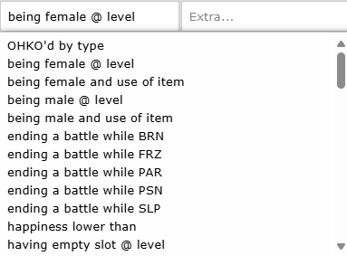
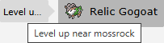
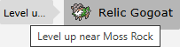

# Evolution Methods



Most evolution methods are self-explanatory (`level up @ map` or `trade holding item`). However, a couple have caveats that are worth explanation.

## Happiness Lower Than

This evolution method does not require level-up to activate. Instead, it checks the evolution whenever the Pokemon's happiness is altered. A **decrease** in happiness can happen via:

 - Item use, such as [Energy Root](<https://pokengine.org/items/06x9i6tq/Energy+Root>)
 - [`&happiness`](<https://pokengine.readthedocs.io/en/latest/Code_Library/triggers/#happinesss>) trigger
 - A Pokemon faints

No matter what, the unhappiness evolution attempt will not run until:
 
 - The player is available (e.g., no dialogue and not frozen)
 - The map is available (e.g., no fade screen)
 - The mon is available (in the party and conscious)
 
If the mon gets deposited into a PC before it is revived, the evolution attempt will cease until another increase or decrease in happiness occurs. 

## Level Up Near [Location]

This evolution method requires an in-game tile with the location name. For example, if you want Eevee to evolve into Leafeon while leveling up near a Moss Rock, so your map should include the following jCoad:
```json
evoarea(Moss Rock)
```

The player is "near" the location if the specified tile is on screen.

Note that the location should always be the proper name (`Moss Rock`, not `mossrock`). The incorrect name will display on the website, which looks a bit sloppy:



A more professional example is below.

