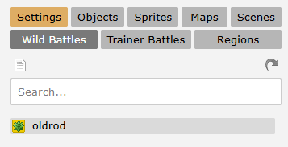

# Fishing System Overview

Below is an example of the engine code used for the [Old Rod](<https://pokengine.org/items/06xh999l/Old+Rod>):  

```json
fishingEncounter: "oldrod",
hookChance: 25
```

As shown, it attempts to fish using the `"oldrod"` [encounter](<https://pokengine.readthedocs.io/en/latest/Code_Library/objects/#encounters>) list.

## Setting Up Rod-Based Fishing

To set this up:

- In **Mapbuilder**, create an encounter list named exactly after the rod (e.g., `oldrod`).

  

- The system will use this list when the rod is used.

- You can also create **custom rods** by assigning them unique names and building separate encounter lists to match.

This allows for flexible fishing setups, such as different rods catching different Pokémon in the same area.

## Fishing for Items

In addition to Pokémon, the engine includes default functionality that allows players to occasionally fish up items instead.

This system was designed to offer alternate ways to earn money in an MMO environment, especially where trainer battles do not reset.  

Fishing for items adds variety and helps support economic balance by giving players repeatable, non-combat ways to profit.

There is a **16.65% chance** (1/6) to fish up an item every time you successfully reel in.

### Item Drop Rates

You can also search for these items using the search term:  
`items #fishing+chance`

| Item          | Chance (if you fish up an item) | Sell Price |
|---------------|----------------------------------|------------|
| Trash         | 30%                              | 10         |
| Heart Scale   | 20%                              | 50         |
| Sticky Barb   | 20%                              | 100        |
| Prism Scale   | 12%                              | 250        |
| Shell Bell    | 12%                              | 100        |
| Pearl         | 4%                               | 700        |
| Big Pearl     | 3%                               | 3,750      |
| Pearl String  | 2%                               | 5,000      |
| Comet Shard   | 1%                               | 15,000     |

!!! warning
    These item fishing rates are configured as **engine defaults** and are shared across the game.  
    Changing them may disrupt **global balancing**, especially in regions using **GPC**.  
    It’s strongly recommended to leave these values untouched unless you have a specific, isolated use case.

## Customizing Odds

The canonical rods have the following odds to hook:
 - Old Rod: 25%
 - Good Rod: 50%
 - Super Rod: 75%
 - Epic Rod: 100%

If unspecified, the item chance is 1/6 on a successful hook.

### Custom Rods
Rods can use `hookChance` and `itemChance` as properties. For example, the [Hot Rod](<https://pokengine.org/items/06cd8o4n/Hot+Rod>) has good hook odds, but never fishes up items:
```js
fishingEncounter: "hotrod",
hookChance: 75,
itemChance: 0
```

### Pokemon Abilities
If a Mon is first in your party, a fishing cast will check if their ability has the `onCalcHookChance` function. For example, [Suction Cups](<https://pokengine.org/abilities/05qd4esj/Suction+Cups>) has:
```json
onCalcHookChance: (ogChance) => { return 2*ogChance; }
```

### Variables
The following `ev`, `var`, or `mapvar` may be set to alter the odds (for example, during a fishing tournament or a specific map):
 - `mapvar[fishing_hook_multiplier]`
 - `mapvar[fishing_item_multiplier]`

For example, using the Old Rod has a 25% chance to hook anything, and a 1/6 chance for that hook to be an item.
 - If `mapvar[fishing_item_multiplier]=6`, the player will get an item 25% of the time (and never get a Mon).
 - If `mapvar[fishing_hook_multiplier]=4`, the player will get a hook 100% of the time split between Mons (5/6) and items (1/6).
 - If both `mapvar[fishing_item_multiplier]=6` and `mapvar[fishing_hook_multiplier]=4`, the player will hook an item on every cast.